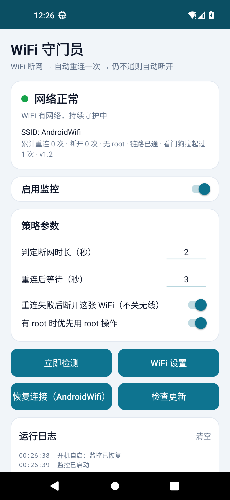
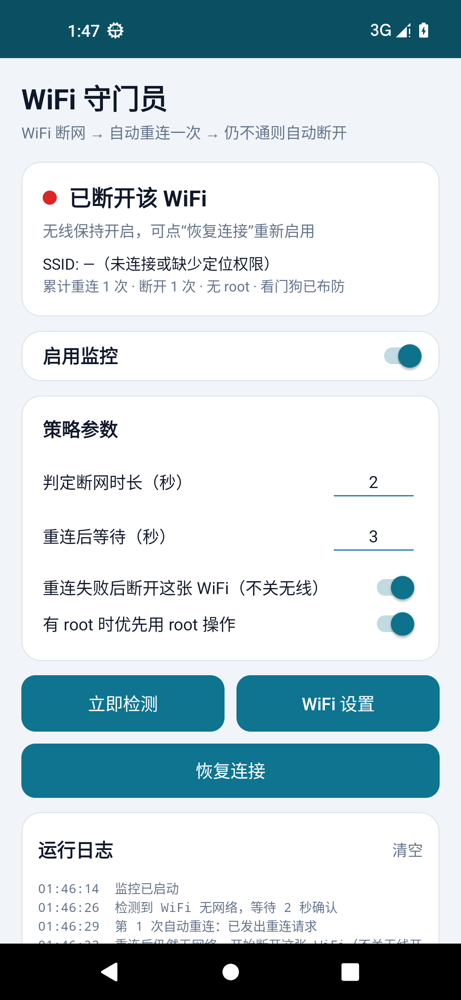

# WiFi 守门员（WiFiGuard）

一个很小的 Android 应用：**连着 WiFi 但上不了网**时，2 秒内确认 → 自动重连一次 → 再过 3 秒仍然没网 → 断开这张 WiFi（**只断开连接，不关无线开关**）。

安装包：`dist/WiFiGuard-1.2.apk`（约 85 KB，已签名，可直接安装；覆盖安装会保留设置）

---

## 1. 行为

| 阶段 | 触发条件 | 动作 |
| --- | --- | --- |
| 巡检 | 每 1.5 秒一次轻量探测（2 次 TCP 握手，绑定在 WiFi 链路上，不走流量） | 只判断“这张 WiFi 通不通” |
| 判定 | 连续 `判定断网时长`（默认 **2 秒**）都失败 | 进入重连 |
| 重连一次 | 判定成立 | `reconnect()` 重新关联；不行再 `disableNetwork+enableNetwork` 强制重连；有 root 则 `svc wifi reassociate` |
| 再判定 | 重连后等 `重连后等待`（默认 **3 秒**） | 期间每 0.5 秒探一次，一恢复就立刻回到正常 |
| 断开 | 3 秒后仍然没网 | `disconnect()` 断掉这张 WiFi，**无线保持开启**，手机自动改用移动网络 |

实测节奏（Android 13 模拟器，多次重复）：屏蔽外网后 **1.3~2.5 秒**发现，**+2.4 秒**发出重连，**+3.8 秒**完成断开，总共约 8 秒。

断开后有两种收尾：

- 系统如果自己又把这张网连回来，应用会**再断一次**（最多 3 次，间隔 10 秒），仍然不行就停手并在通知里提示手动处理；
- 想重新用这张 WiFi，点界面上的 **「恢复连接」**（会带上网名），或者到系统 WiFi 设置里点一下该网络。

## 2. 崩溃兜底（后手）

这不是一句口号，是三层互相独立的保险：

| 层 | 机制 | 覆盖场景 |
| --- | --- | --- |
| 1 | 前台服务 `START_STICKY`，加上引擎线程每次 tick 都 try/catch | 单次异常、进程被系统回收 |
| 2 | 心跳文件 `files/guard.hb`（每轮刷新）+ **系统闹钟每 60 秒**叫醒 `WatchdogReceiver`；发现心跳超过 15 秒没更新，就把前台服务重新拉起来 | 主进程崩溃、服务被停掉 |
| 3 | 开机自启、覆盖安装自启；只有用户点“停止监控”才撤掉闹钟 | 关机重启、升级 |

闹钟由系统持有，**和应用进程无关**，所以哪怕整个应用进程没了，60 秒内也会被系统叫醒并恢复监控。

崩溃堆栈会写进应用私有目录的 `crash.log`，界面上也会显示「看门狗拉起过 N 次」，方便判断稳不稳。

实测：

- `adb shell am stopservice` 停掉服务，20 秒后打一次看门狗广播 → 日志出现「看门狗：主服务心跳停了 20 秒，正在重新拉起」，服务恢复前台运行；
- `adb shell am crash` 杀掉进程 → 系统 1 秒内按 `START_STICKY` 自动重启服务，界面显示「看门狗拉起过 1 次」。

## 3. 实测记录（Android 13 / API 33 模拟器）

测试方法：`iptables -I OUTPUT -o wlan0 -j DROP`，让 WiFi 保持“已连接”但所有流量被丢弃，
完全等价于“连上了路由器但没有外网”。真实日志：

| 相对时间 | 日志 |
| --- | --- |
| +0.0s | （开始屏蔽 wlan0 出向流量） |
| +1.6s | 检测到 WiFi 无网络，等待 2 秒确认 |
| +4.0s | 第 1 次自动重连：已发出重连请求 |
| +7.7s | 重连后仍然无网络，开始断开这张 WiFi（不关无线开关） |
| +7.7s | 断开动作：disconnect()=true，disableNetwork()=false |
| +7.7s | 已断开这张 WiFi，但系统不允许暂停自动连接，可能会自己连回来 |

同时确认：

- `settings get global wifi_on` **仍然是 `1`**（无线没关），但 `Supplicant state: DISCONNECTED`（连接已断）；
- 恢复网络后点「恢复连接」，状态自动回到「网络正常」。

| 网络正常 | 判定失败已断开 |
| --- | --- |
|  |  |

## 4. 安装与首次设置

1. 把 `dist/WiFiGuard-1.2.apk` 传到手机，点击安装（需允许“安装未知来源应用”）。
2. 打开应用 → 打开 **启用监控** 开关。
3. 首次会请求 **定位权限**：Android 规定读取 WiFi 名称（SSID）需要它。不授权也能用，只是界面上看不到 WiFi 名字。
4. 建议点一下 **忽略电池优化**，否则部分机型后台被杀后监控会停。
5. 通知栏出现常驻通知「WiFi 守门员」，说明前台服务在跑；点通知里的「停止监控」可随时退出。

开机自启：只要开关是打开的，重启后监控会自动恢复。

## 5. 关键限制（务必先读）

Android 从 10（API 29）开始**禁止普通应用开关 WiFi**——`setWifiEnabled` / `reconnect` / `disconnect`
这些接口对 targetSdk ≥ 29 的应用直接失效。

本应用的做法是 **targetSdk = 28**，以保留旧接口。实践中的结果：

- 大多数机型的 Android 10 / 11 / 12 / 13 上，这样可以正常重连和断开（本机 Android 13 实测通过）；
- 部分厂商 ROM（尤其换了 WiFi 框架的定制系统）会额外拦截，接口会返回 `false`；
- 被拦截时应用不会静默失败：日志里写明「系统拒绝…」，并发一条通知让你手动处理；
- **有 root 一定可用**（应用会自动检测，`启用 root` 开关默认打开）。

另外，`disableNetwork()`（暂停该网络的自动连接）在 Android 13 上返回 `false`，
所以“断开”靠的是 `disconnect()` + 反复纠正：系统若自动连回来且仍然没网，会再断一次。
想彻底不让它连回来，只能在系统设置里关掉该热点的“自动连接”，或关闭 WiFi 开关。

## 6. 参数

| 参数 | 默认 | 含义 |
| --- | --- | --- |
| 判定断网时长 | 2 秒 | 连续多久探测失败才算“真没网”，避免误判 |
| 重连后等待 | 3 秒 | 重连后给网络多久恢复时间，超时才断开 |
| 重连失败后断开这张 WiFi（不关无线） | 开 | 关掉则只重连不断开，会循环重试 |
| 有 root 时优先用 root 操作 | 开 | 关闭后只用普通接口 |

## 7. 界面

- 顶部状态卡片：当前状态、SSID、累计重连/断开次数、是否有 root、看门狗状态
- 「立即检测」：立刻跑一次状态机
- 「WiFi 设置」：Android 10+ 直接弹 WiFi 快捷面板
- 「恢复连接」：把上次被断开的网络重新启用（按钮上会显示网名）
- 运行日志：最近 300 条，带时间戳

## 8. 发布与更新（GitHub Releases）

App 内置了「检查更新」：读 `https://api.github.com/repos/<仓库>/releases/latest`，
用 `tag_name` 算出 `versionCode` 和本机比较，有新版就弹窗，确认后下载 APK 并调起系统安装器。

### 一次性配置

1. 在 GitHub 建一个**公开**仓库（可以只放一个 README，不需要传源码）。
2. 改 `app/src/main/java/com/wifiguard/Config.java` 里这一行：

   ```java
   public static final String GITHUB_REPO = "CHANGE_ME/wifi-guard";  // 改成 你的用户名/wifi-guard
   ```

3. 重新打包。

### 以后每次发版（三步）

```powershell
# 1. 打包：版本号在这里给，versionCode 自动算（1.2.1 -> 10201）
powershell -ExecutionPolicy Bypass -File .\build.ps1 -Version 1.2.1

# 2. 传到 GitHub Release（装了 gh CLI 就一条命令；也可以在网页上手动拖文件）
gh release create v1.2.1 .\dist\WiFiGuard-1.2.1.apk --title "1.2.1" --notes "修复 xxx"

# 3. 手机上打开 App → 点「检查更新」→ 下载并安装
```

App 每次打开还会自动检查一次（24 小时内不重复），有新版本直接弹窗。

### 规则与坑

- **版本号**：`versionName` 用 `主.次.修`，`versionCode = 主*10000 + 次*100 + 修`
  （1.2.1 → 10201）。`build.ps1` 和 App 内用的是同一套换算。
- **Release 里必须挂 `.apk` 附件**，否则会提示“这个 Release 里没有 .apk 附件”。
- **tag 用 `v1.2.1` 这种格式**，开头的 `v` 会被自动去掉。
- **签名必须一致**：一直用 `keystore/debug.keystore`。签名一变，手机拒绝覆盖安装。
- **首次安装**要在系统里允许本应用“安装未知应用”，App 会弹窗引导你去打开。
- **仓库必须公开**：私有仓库要 token，token 打进 APK 等于公开。
- 未登录的 GitHub API 限流 60 次/小时，正常用远远够。
- 国内访问 GitHub 偶尔慢，下载失败会给出提示，重试即可。

## 9. 重新打包

工程是**不依赖 Gradle** 的最小结构（纯 Java、无 AndroidX），用 `aapt2 + javac + d8 + zipalign + apksigner` 直接出包：

```powershell
cd wifi-guard
powershell -ExecutionPolicy Bypass -File .\build.ps1 -Version 1.2.1
# 产物：dist\WiFiGuard-1.2.1.apk（versionCode 10201）
```

双击 `build.cmd` 也可以。默认工具链路径（本机已装好）：

- SDK：`C:\AndroidBuild\sdk`（build-tools 34.0.0、platforms/android-34、platform-tools）
- JDK：`C:\AndroidBuild\tools\jdk\jdk-17.0.20.1+1`

换机器时用参数覆盖：`-Sdk <sdk路径> -Jdk <jdk路径>`。
版本号用 `-Version` 传，`versionCode` 会按 `主*10000+次*100+修` 自动算。

用的 `keystore/debug.keystore`（口令 `android`，别名 `androiddebugkey`）签名，只能自用；
要上应用商店得换成自己的正式签名，而且 targetSdk 28 不满足商店上架要求。

## 10. 代码结构

```
app/src/main/
├── AndroidManifest.xml
├── java/com/wifiguard/
│   ├── MainActivity.java     界面、权限、参数、恢复连接
│   ├── MonitorService.java   前台服务 + 常驻通知 + 心跳
│   ├── GuardEngine.java      状态机（巡检 → 2s 判定 → 重连 → 3s → 断开）
│   ├── NetUtils.java         绑定 WiFi 链路的并行探针 / 重连动作 / root
│   ├── WatchdogReceiver.java 看门狗：心跳超时就拉起服务
│   ├── AlarmScheduler.java   60 秒系统闹钟（进程死了也能唤醒）
│   ├── Heartbeat.java        心跳文件 + 崩溃日志
│   ├── WigApp.java           崩溃日志记录
│   ├── BootReceiver.java     开机 / 升级后自启
│   ├── Prefs.java            设置存取
│   ├── Logx.java             进程内日志
│   ├── Config.java           更新源配置（GitHub 仓库名）
│   ├── UpdateChecker.java    读 GitHub Releases / 下载 APK
│   ├── ApkProvider.java      给系统安装器读 APK 的 ContentProvider
│   └── ApkInstaller.java     调起系统安装器
└── res/                      布局、图标、颜色
```

## 11. 已知限制
- 巡检每 1.5 秒一次，是为了把反应压到几秒内；代价是常驻会有少量唤醒。想更省电可以改 `GuardEngine.POLL_ONLINE_MS`。
- 探针依赖具体站点：如果所在网络只放行特定域名，可能误判无网（可改 `NetUtils.HTTP_PROBES`）。
- 需要网页认证的公共 WiFi（Portal）会被判为“能上网”，不会触发断开。
- 深度休眠（Doze）下定时器和闹钟会被延后，检测和看门狗都可能慢一些；忽略电池优化能改善。
- 断开后不会自动连回来（这是需求要求的行为），需要点「恢复连接」。
- 用户手动“强行停止”应用时，系统会清掉闹钟，这种情况下看门狗也会失效，重新打开应用即可恢复。
